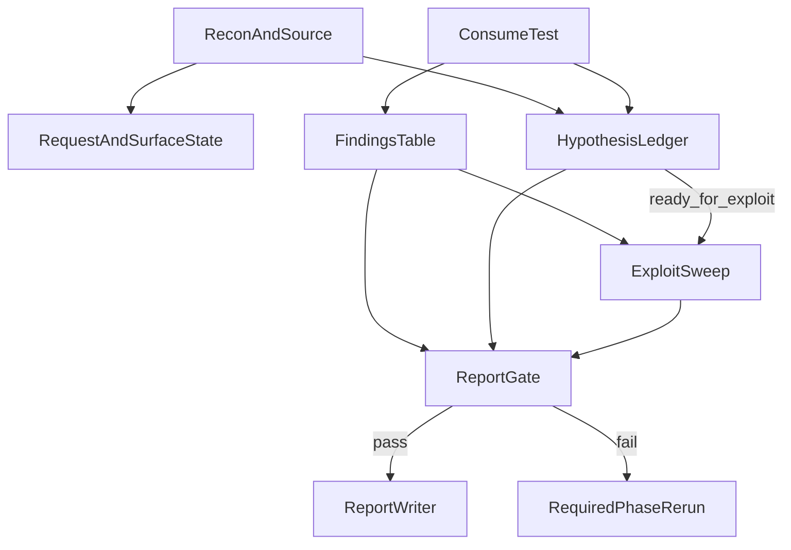

<!-- ea816cb1-9b7e-4f9c-9510-067453927845 -->
---
todos:
  - id: "backend-lifecycle"
    content: "Add hypothesis ledger, exploit disposition, report gate, and approval field rename in backend schema/services/API"
    status: pending
  - id: "cli-and-exports"
    content: "Add record-hypothesis and check-report-gate commands, update exploit review/session commands, and sync readable exports"
    status: pending
  - id: "prompt-contracts"
    content: "Align operator, exploit, vuln, source, handoff, and report prompts with the new lifecycle and ingestion contracts"
    status: pending
  - id: "buffer-priority"
    content: "Add priority to local work_items and make dispatch ordering deterministic"
    status: pending
  - id: "frontend-visibility"
    content: "Expose exploit disposition and unresolved hypotheses in the frontend without adding a new top-level tab"
    status: pending
  - id: "validation"
    content: "Rerender generated prompts and run focused backend, prompt-wording, and frontend verification"
    status: pending
isProject: false
---
# Web Flow Lifecycle Hardening

## Context
The current web flow still overloads `draft`: it is used as speculative backlog, exploit input, and report input at the same time. The implementation should split those concerns cleanly so another agent can reason from canonical state instead of prompt folklore.

```1539:1559:orchestrator/backend/app/services/state_manager.py
SELECT *
FROM assessment_findings
WHERE engagement_id = ?
  AND status != 'merged'
ORDER BY
    CASE status
        WHEN 'exploited' THEN 0
        WHEN 'confirmed' THEN 1
        WHEN 'reported' THEN 2
        WHEN 'blocked' THEN 3
        WHEN 'draft' THEN 4
```

```59:64:agent/scripts/assess/commands/record_finding.py
payload["slug"] = candidate_slug
payload.setdefault("source_name", agent_name)
payload.setdefault("severity", "medium")
payload.setdefault("status", "confirmed")
payload.setdefault("defect_family", payload.get("title", candidate_slug))
```

```38:42:agent/agents/exploit-developer.md
./scripts/assess.py fetch findings \
  | jq '[.[] | select(.status | IN("confirmed","exploited","draft"))
         | {slug, title, severity, status, defect_family, canonical_location, auth_context}]'
```

## Chosen Policy
- Chain-only or unresolved primitives do not belong in `assessment_findings`. Put them in a new hypothesis ledger.
- `draft` stays as a finding status, but it now means: a real validated bug that is not yet report-ready. It never means an untested guess.
- Medium, high, and critical findings require an exploit sweep before report. Low and info findings default to `not_required` exploit handling.
- Unresolved medium+ hypotheses block final report. Each hypothesis records the exact earlier phase that must be rerun via `required_phase`.
- `exploit_disposition` becomes a first-class backend field on findings and is exposed in API, CLI, and UI.
- `source-analyzer` emits machine-ingestable JSONL in a required `#### Requestable Endpoints` section.
- Backward-compatibility shims are not required in this pass. Rename misleading fields instead of dual-reading them.
- Do not add a closable `timed_out` hypothesis status. If time runs out, leave the hypothesis unresolved with notes so the report gate still catches it.

## Target State
- Findings table holds only real bugs with statuses: `draft`, `confirmed`, `exploited`, `blocked`, `merged`, `reported`.
- Hypothesis table holds non-reportable leads with statuses: `open`, `ready_for_exploit`, `promoted`, `rejected`.
- `draft` means the bug is real but the package is incomplete: evidence polish, severity discipline, exploit disposition, blocked metadata, or dedup cleanup is still missing.
- `blocked` is valid only for a real finding whose deeper proof was stopped by policy, environment, infrastructure, or access constraints. The record must carry `blocked_reason`, `blocked_constraint`, and `next_step` in structured details.
- `report-findings` returns only `confirmed`, `exploited`, `blocked`, and `reported` findings. `draft` and all hypotheses are excluded.
- The final report gate fails when any medium+ hypothesis is unresolved, any finding is still `draft`, or any medium+ finding has `exploit_disposition = pending`.



## Implementation Plan

### 1. Backend state model and API
- `orchestrator/backend/app/db.py`: add a new `assessment_hypotheses` table with `hypothesis_key`, `title`, `severity`, `status`, `required_phase`, `defect_family`, `auth_context`, `canonical_location`, `summary`, `evidence_ref`, `notes`, `details_json`, `provenance_json`, timestamps, and an optional `promoted_finding_id`. Add `exploit_disposition TEXT NOT NULL DEFAULT 'not_required'` to `assessment_findings`.
- `orchestrator/backend/app/services/state_manager.py`: add hypothesis normalization, CRUD helpers, list helpers, summary counts, and a canonical `report_gate_status()` function. Gate rules must check `draft` findings, medium+ unresolved hypotheses, medium+ findings with pending exploit disposition, and blocked findings missing required structured metadata.
- `orchestrator/backend/app/services/state_manager.py`: change `list_report_findings()` so it excludes `draft` and all non-reportable lifecycle states. Keep ordering severity-first, but only for report-eligible rows.
- `orchestrator/backend/app/api/assessment.py`: add `/hypotheses`, `/hypotheses/{hypothesis_key}`, and `/report-gate` endpoints. Make finding creation require explicit `status` instead of defaulting to `draft`. Add `exploit_disposition` to finding create and patch models.
- `orchestrator/backend/app/services/engagements.py` and `orchestrator/backend/app/api/engagements.py`: rename `approved_findings` to `approved_exploit_items` so the exploit approval scope can contain finding slugs and hypothesis keys.
- `orchestrator/backend/app/services/state_manager.py`: extend `assessment_summary()` with `hypothesis_statuses`, `open_hypothesis_count`, and a lightweight `report_gate` payload so the UI can show blockers without recomputing logic.

### 2. CLI commands and readable exports
- Add `agent/scripts/assess/commands/record_hypothesis.py` and a new helper module `agent/scripts/assess/lib/hypotheses.py`. Follow the same backend-first pattern as findings: allocate a stable `HYP-*` key, POST canonical state first, then sync a readable `hypotheses.md` export.
- `agent/scripts/assess/cli.py`: register `record-hypothesis` and `check-report-gate` as first-class commands.
- `agent/scripts/assess/commands/record_finding.py`: keep the CLI-side default `status = confirmed` unless the payload explicitly sets `draft`. Inject `exploit_disposition = pending` for medium+ findings unless the payload explicitly supplies another value. Set low/info findings to `not_required` by default.
- `agent/scripts/assess/lib/findings.py`: include `exploit_disposition` in `findings.md`, and show blocked metadata when present so the readable export matches the backend lifecycle.
- Add `agent/scripts/assess/commands/check_report_gate.py`: query the new backend `/report-gate` endpoint and exit non-zero with a concise blocker list.
- `agent/scripts/assess/commands/review_exploits.py`: stop showing `draft`. Show two sections only: medium+ `confirmed` findings and medium+ hypotheses in `ready_for_exploit`.
- `agent/scripts/assess/commands/check_exploit_gate.py`, `approve_exploit.py`, and `launch_session.py`: replace `approved_findings` with `approved_exploit_items`, and allow launch sessions to assign either finding slugs or hypothesis keys. The generated session prompt should render assigned findings and assigned hypotheses in separate sections.
- `agent/scripts/assess/commands/check_coverage.py`: move the gate to backend `surfaces`. If local `surfaces.jsonl` exists and does not match backend state, fail with a drift message instead of trusting the local file.

### 3. Local work-buffer priority
- `agent/scripts/schema.sql`: add `priority INTEGER NOT NULL DEFAULT 50` to `work_items`.
- `agent/scripts/assess/lib/db.py`: persist `priority` in `db_insert_work_item()`.
- `agent/scripts/assess/commands/ingest_endpoints.py` and `ingest_spec.py`: assign deterministic priorities when creating work items. Use `api-spec=100`, `api=90`, `form=80`, `upload=80`, `graphql=80`, `websocket=80`, `page=60`, `javascript=50`, `data=45`, `stylesheet=40`, `unknown=30`.
- `agent/scripts/assess/commands/dispatch.py`: fetch in `priority DESC, created_at ASC` order. Keep the current type-based routing model; do not add a new cross-type scheduler in this pass.
- `agent/skills/case-dispatching/SKILL.md`: update the operator guidance so “priority” is real and matches the buffer implementation.

### 4. Prompt and workflow alignment
- `agent/operator-core.md`: remove the “drive HIGH findings to exploitation” wording. Require Phase 3 coverage resolution before Phase 4 unless the human explicitly overrides phase order. Add an explicit `./scripts/assess.py check-report-gate` step before dispatching `report-writer`.
- `agent/operator-core.md`: redefine Phase 4 input as medium+ confirmed finding slugs plus explicit `ready_for_exploit` hypothesis keys. Do not pass `draft` findings into exploit work.
- `agent/agents/vulnerability-analyst.md`: redefine `draft` as “real bug, not yet report-ready.” Route speculative, chain-only, or timeout-limited medium+ leads into `record-hypothesis` instead of `record-finding`. Change dedup guidance from `fetch report-findings` to `fetch findings`, because `report-findings` will now be intentionally filtered.
- `agent/shared-constraints.md`: change the global dedup guidance from `report-findings` to `findings` for the same reason.
- `agent/agents/exploit-developer.md`: remove `draft` from the startup finding query. Add a second query for `ready_for_exploit` hypotheses. Require exploit-developer to patch `exploit_disposition` on every medium+ finding it touches.
- `agent/agents/source-analyzer.md` and `agent/skills/source-analysis/SKILL.md`: add a required `#### Requestable Endpoints` section that emits one JSON object per line in the exact shape accepted by `assess.py ingest-endpoints`. Keep `#### Surface Candidates` separate for trust-boundary hints that are not directly requestable.
- `agent/skills/report-generation/SKILL.md`: run `./scripts/assess.py check-report-gate` before any report query, treat failure as a hard stop, and stop describing `draft` as part of the report lifecycle.
- `agent/references/handoff-protocols.md`: replace “low confidence -> durable draft finding” with “concrete but unresolved -> durable hypothesis”. Restrict exploit-phase handoff to medium+ confirmed findings plus `ready_for_exploit` hypotheses.
- `agent/skills/nuclei-scanning/SKILL.md` and `agent/skills/osint-recon/SKILL.md`: when a lead is concrete but not yet validated enough for a finding, record a hypothesis instead of leaving it as prose-only intelligence.
- `agent/operator-core.md`: rename the `vulnerability-analyst` roster label from “Quick triage: 1-2 probes per vuln” to “Disciplined validation with minimal decisive probes”.

### 5. Generated prompt artifacts
- Because `agent/operator-core.md` is a rendered source, rerender prompt artifacts after the prompt edits using `agent/scripts/render-operator-prompts.sh repo`.
- Validate the regenerated files that are tracked in the repo: `agent/AGENTS.md`, `agent/CLAUDE.md`, `agent/.codex/agents/*`, and `agent/.claude/agents/*`.

### 6. Frontend alignment
- `orchestrator/frontend/src/lib/api.ts`: add hypothesis types, `hypothesis_statuses`, `open_hypothesis_count`, `report_gate`, and `exploit_disposition`. Rename `approved_findings` to `approved_exploit_items` in the engagement model.
- `orchestrator/frontend/src/components/FindingsTab.tsx`: show an `exploit_disposition` badge next to lifecycle state and add a secondary “Unresolved hypotheses” section fed from the new API, including severity and `required_phase`. Do not create a new top-level tab in this pass.
- Keep the UI minimal: the goal is visibility of blockers and lifecycle state, not a new workflow surface.

### 7. Validation and test updates
- `orchestrator/backend/tests/test_engagements_api.py` and `test_init_engagement.py`: update the renamed exploit approval field and new scope payload shape.
- Add backend tests for hypothesis CRUD, report-gate failures, report-findings filtering, blocked metadata enforcement, and exploit disposition gating.
- Add CLI tests for `record-hypothesis`, `check-report-gate`, `review-exploits`, and exploit approval/session launch with hypothesis keys.
- Update prompt wording tests so they assert the new report gate step, the new source-analyzer endpoint contract, and the removal of `draft` from exploit intake.
- After the code and prompt changes, run focused backend tests, `uv run --directory orchestrator/backend pytest tests/test_prompt_wording.py`, and `npm run build` in `orchestrator/frontend`.

## Notes For The Implementing Agent
- Do not preserve the old `approved_findings` name. Rename it cleanly to `approved_exploit_items` everywhere.
- Do not let `report-findings` remain a general-purpose “all findings” endpoint. It is report-only after this change.
- Do not close medium+ hypotheses with a harmless-looking timeout status. Leave them unresolved so the report gate forces the right phase rerun.
- Do not use the hypothesis ledger as a soft clone of the findings table. It is specifically for non-reportable work items and chain-only leads.
- Do not add a new exploit scheduler. The local priority work only needs to make the existing routing order real and deterministic.