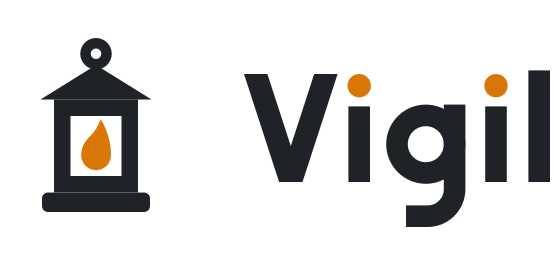
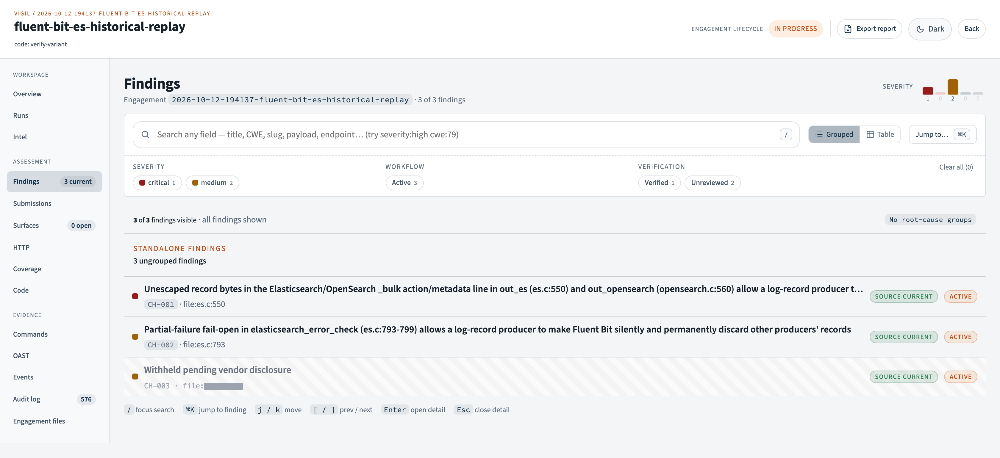
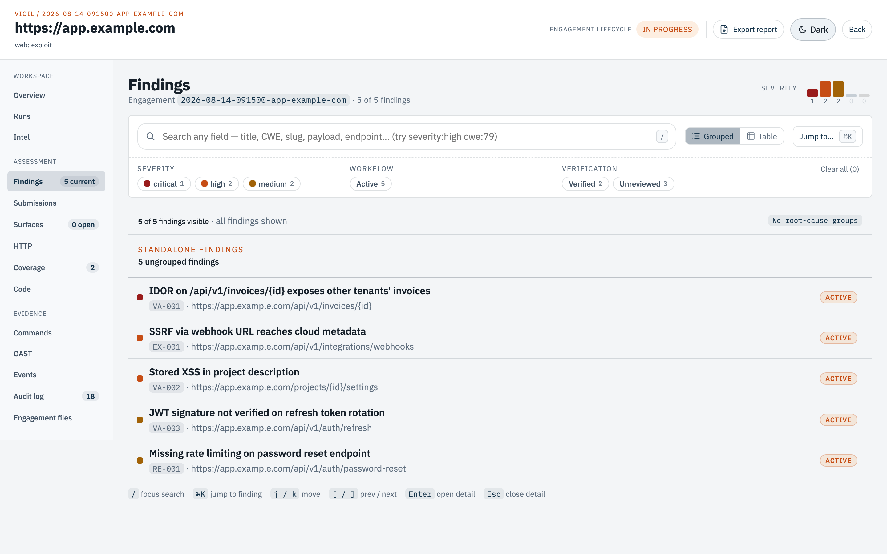

<div align="center">

<picture>
  <source media="(prefers-color-scheme: dark)" srcset="docs/assets/logo/vigil-lockup-dark.svg">
  
</picture>

**Find bugs, follow the code, and prove what an attacker can do.**

[](LICENSE)
[](https://github.com/VigilOSS/Vigil/actions/workflows/ci.yml)
[](https://www.python.org/downloads/)
[](https://github.com/VigilOSS/Vigil/releases/tag/v2.3.0)

</div>

Vigil is an AI harness for code audits, web pentests, and bug bounty hunting. It coordinates
Claude Code or Codex through broad review, focused rereads, authenticated testing, and runtime
reproduction. Start with a codebase, a live application, or both.

The first pass is a starting point. Higher-risk code gets another look with a different
objective. Specialists follow callers, challenge guards, join paths across modules, and hunt
variants of defects they find. Promising leads stay on the books when runtime proof or access
is still missing. Findings, evidence, coverage, and handoffs carry across sessions.

Vigil was used by its creator to reach the top 75 individuals worldwide by reputation on
HackerOne’s Q4 2026 leaderboard. Built by an application security engineer, it was refined over
eight months and hundreds of hours of hands-on use. Much of that work is in the methodology:
how to find something worth testing, how to tell a failed test from a real negative, and how to
keep a plausible source bug from becoming an unsupported impact claim.

**You stay in charge.** Review what the agents are testing and why. Ask for another
pass when a conclusion is weak, check the proof, and read the final report. A completed workflow
is useful accounting; the quality of the investigation still depends on the model and your review.

> **Authorized use only.** Vigil drives offensive tooling against live systems. Use it only
> with explicit authorization and a reviewed scope. You are responsible for commands,
> credentials, infrastructure, and target effects. See [SECURITY.md](SECURITY.md) for private
> vulnerability reporting and how Vigil handles your engagement data, and [LICENSE](LICENSE)
> for the warranty.

## See it work

One [Fluent Bit](https://github.com/fluent/fluent-bit) engagement began with
`plugins/out_es/es.c`. Following the code expanded the admitted analysis scope to nine files.

| | Result |
|---|---|
| Elapsed session | **2 h 59 m**, from the initial brief to a finished advisory |
| Analysis scope | **9 files / 2,572 LOC**, all nine reviewed; a separate 495-file core tree indexed for context |
| Findings | **3**, reproduced at runtime against a live Elasticsearch 8.15.0: one critical, two medium |
| Agent work | 17 tasks across five specialist agents; 945 tool calls and 7.2 hours of combined agent time |

https://github.com/user-attachments/assets/bf99a0bb-df71-4966-a390-708cf23d9e62

[Watch the video](https://vigiloss.github.io/Vigil/vigil-fluent-bit-audit.mp4) if it does not play
here. It is heavily trimmed to eleven moments from the three-hour session.

**This was a historical replay.** The source was pinned before an upstream fix. Repository
lookups and cloning were off limits; CVE, advisory, and changelog checks waited until the
write-up was done. This demonstrates the workflow on that revision, rather than a fresh
zero-day discovery benchmark. One finding remains withheld pending vendor disclosure.

<picture>
  <source media="(prefers-color-scheme: dark)" srcset="docs/assets/fluent-bit-findings-dark.png">
  
</picture>

<details>
<summary>What the investigation established</summary>

`out_es` pastes a record-derived index name into Bulk API syntax. A log producer who controls
that field can add an extra action line, sent under Fluent Bit's Elasticsearch credential.
Against a cluster with security enabled and a collector role restricted to `fluent-bit*`, one
record deleted another producer's document without Fluent Bit recording an error. The sibling
`out_opensearch` implementation carries the same code. Upstream fixed this in 4.2.6; it has
no CVE, GHSA, or published advisory.

A separate verifier dispatch challenged the critical finding five ways. Two challenges were
resolved by runtime capture. Severity changed from 9.1 to 7.1 on scope reasoning, then returned
to 9.1 after an authenticated retest measured the availability loss. A third agent received
only the draft advisory and found six errors, including repeated incorrect line citations and
a proposed patch that would have hung the process. Those errors were corrected before release.

Lab commands went through the audited execution surface, retaining their purpose, target,
exit status, and output. Advisory claims trace to those records, runtime transcripts, or
verifier scripts. The withheld finding stays with maintainers until a fix ships or the
disclosure window closes.

</details>

## Quick start

Install [uv](https://docs.astral.sh/uv/getting-started/installation/), then install the release
and set up your private workspace. The release includes the CLI, backend, prompts,
documentation, and prebuilt UI; Git and Node are not needed.

```bash
uv tool install --from https://github.com/VigilOSS/Vigil/releases/download/v2.3.0/vigil-2.3.0-py3-none-any.whl vigil
vigil install
```

Install and sign in to an agent client: **Claude Code, Codex, OpenCode, ZCode, Goose, Kimi,
or Pi**. Setup differences are in [agent clients](docs/agent-clients.md), and provider limits
on security testing are in [models and access](docs/model-access.md). ZCode desktop has extra
setup steps: see [ZCode setup](docs/zcode-setup.md).

Then start Vigil:

```bash
vigil engagement start
```

Choose **Create new engagement**, answer the questions, then pick your client and a mode:
`code` to audit source, `web` to test a live application. Later runs of the same command list
your engagements by recent activity.

Vigil opens your client with a lead agent. It plans the work, sends specialist agents to
investigate, and records what they find. The CLI and prompt files call this lead agent the
*operator*. Talk to it in your client like any other conversation.

### Audit source code

Source review needs only `uv`, your agent client, and ripgrep (`rg`) on the host. Docker can
wait until the work needs to build or run the target.

```bash
vigil engagement create --type code --name acme --source-dir ./acme
vigil engagement start
```

`--source-dir` points at the original project. Before copying it, the lead agent asks you to
confirm the source and that you trust its build and test code to run inside Vigil's sandbox.
It then makes one sealed audit copy. The original stays untouched, and Git history is
optional. Without `--source-dir`, put the files in the `source/` folder that `create` prints.

Compiling or running target code, reproducing a bug, and fuzzing happen in Vigil's Kali
container. Start Docker before that point; Vigil starts the container on first use. The first
start downloads the image, or builds it locally when no prebuilt image is available, which
can take a while. See [code analysis](docs/code-analysis.md).

### Test a live application

Start Docker, then create the engagement:

```bash
vigil engagement create https://app.example.com
vigil engagement start
```

Replace the example with your authorized target. Review the engagement's `scope.json`, and
tell the lead agent what is allowed, what is excluded, which test accounts to use, and the
program rules. Live exploit work waits for your approval by default.

On macOS and Windows Docker Desktop, large DNS and liveness scans run on the host instead of
in the container; `vigil doctor --install-host-tools` installs the tools they need. See
[installation](docs/installation.md).

For authenticated testing, either import existing cookies and headers with
`vigil auth import <engagement-key> --source cookies-and-headers.json`, or run
`vigil mitmproxy start`, point a browser at the proxy on `127.0.0.1:8080`, and log in. HTTPS
capture needs the proxy's CA certificate trusted by that browser. Use separate target accounts
for cross-account tests; they are unrelated to your Claude or Codex login. See
[authentication](docs/authentication.md).

### Continue the investigation

Run `vigil engagement start` again and pick the same engagement. The lead agent reloads the
recorded progress, evidence, blockers, and handoffs instead of relying on conversation
history. In a conversation that is already open, run `vigil-resume` yourself. Always start
through `vigil engagement start`, which checks that the client, backend, and runtime are ready.

The UI at `http://127.0.0.1:18000` shows each engagement's findings, evidence, coverage, proof
work, the commands that ran, and an activity log of recorded actions.

For example prompts to deepen code or web testing, check coverage, or challenge a
finding, see the [engagement prompt playbook](docs/engagement-prompt-playbook.md).

## How Vigil hunts

### Start broad, then change the question

A guessed bug can become the limit of an investigation. Code hunters examine the applicable
vulnerability classes before checking the architect's suggested hypotheses. They receive the
source, its structural index, the threat model, and an objective. Small, related file batches
leave room to reason about the code rather than skim an oversized context dump.

Higher-risk files then get a fresh hostile reread with prior findings left out of the intended
dispatch context. The objective changes from finishing the review to finding what survived it.
Focused passes apply different lenses: access control, error handling, business logic, state,
lifetime, and other classes relevant to the target. A clean result under one lens leaves room
for another.

The developer lens asks what the implementation assumes: a copied endpoint kept its guard,
an old API has the same controls, a framework default is safe, a client validates the input,
or a failed allocation leaves the caller in a usable state. Those assumptions become questions
to investigate, rather than findings by themselves.

### Follow the code across boundaries

Hunters trace callers, transformations, guards, and the operation that can cause harm. They
also examine supported state and lifetime sequences, where there may be no simple input-to-sink
path. The structural index helps account for functions; it does not replace reading them.

A dedicated pass examines crossings between modules. Does one module rely on a guarantee the
other does not provide? Can a second entry path bypass the guard? Can a read, redirect, SSRF,
or state change combine with another primitive? Larger codebases are split into bounded seams,
then a further pass checks how those seams join into longer chains.

The product matters. A library's supported API or callback sequence can expose a real defect
even without the embedding application's source. Vigil's method separates that product path
from deployment-specific attacker access and limits the impact claim to the evidence available.
It also asks whether the alleged bug gives the caller any power they did not already have.

### Use a finding to find its relatives

A surviving defect triggers variant work: sibling routes, controllers, providers, content
types, authentication contexts, and copied implementations. Historical fixes can seed a hunt
for incomplete patches and semantic siblings. Related findings are linked by root cause while
retaining their distinct paths and outcomes.

### Prove the test worked

A timeout, WAF challenge, empty output, validation error, or stale login can invalidate a test.
Vigil's methodology calls for a working positive control on the same route, identity, and
gateway before accepting a negative. Failed or incomplete measurements remain visible as
inconclusive work. Previous negatives guide the next check and can be reopened when the
identity, technique, or target state changes.

One host can contain several substantial applications. Web coverage tracks application units,
inputs, identities, and probes so a quick host touch is distinguishable from deeper testing.
Specialists concentrate on promising surfaces, change technique when attempts stop teaching
anything, and return to unresolved breadth. Named identities support authenticated replay and
cross-account tests; you still need to provide genuinely distinct working accounts.

### Carry source findings through to runtime proof

A suspicious line is the start of a claim. The workflow asks for the shipped entry point or
supported operation, feasible preconditions, a failed security property, and a harmful outcome.
Source-backed leads waiting for runtime proof remain parked. Missing access is recorded as a
blocker. Program rules that forbid the final test are recorded alongside the unproven step.

Local reproduction of a library API, parser, or other supported code path stays in the code
workflow and runs in Kali. When proof needs a live application, the lead agent can send a web
specialist from the same session. It tests only in-scope hosts, and live work still needs
approval under the engagement's exploit policy. The result is added to the same finding. See
[tracks and modes](docs/engagements.md#tracks-and-modes).

For bug bounties with source maps, the lead agent can recover the served source and audit it
in the code workflow. Those findings can then guide live testing under the program's scope.

### Make the claim survive another agent

A finding has to stand on its evidence. Confirmation requires attributable proof from a
different registered dispatch. The workflow calls for a fresh agent to follow the authored
reproduction steps and another fresh-context review of the external report. Report writers
work from the recorded proof and reproduction sequence.

For medium-or-higher findings, the versioned per-finding submission flow checks that the
accepted review still matches the current report and attachments. Review instructions aim
to reduce anchoring; they cannot establish that an agent actually reasoned independently.
Human review remains necessary.

Report-writing rules favor demonstrated impact, short reproducible steps, and facts stated
once. If evidence supports less than the initial theory, the claim changes with it.

## What coverage tells you

Coverage records investigation work. It does not measure how many bugs exist or establish
that every vulnerability was found.

| Track | What is recorded |
|---|---|
| Code | A sealed source snapshot, structural index, file/function review, applicable-class effort, and unresolved structural or context gaps. Reference-only source remains available for tracing without counting as reviewed analysis scope. |
| Web | Hosts, application units, inputs, identities, and probes, including untested and inconclusive work. Relevant applications can carry class-specific depth requirements and recorded deferrals. |
| Continuation | Findings, evidence, dispatches, handoffs, work ownership, and blockers. These reconstruct the investigation; they are not a portable checkpoint of the native client's entire conversation or execution. |

Readiness checks use the recorded state to identify unfinished work and integrity problems.
Some gaps block progress, some warn, and some accept an explicit deferral or audited override.
A code audit cannot be forced to complete with outstanding durable coverage debt. None of
these checks can decide whether the reasoning was good enough or the target is free of bugs.

The methodology lives in the [lead agent prompt](agent/AGENTS.md),
[specialist roles](agent/agents/), [skills](agent/skills/), and [references](agent/references/).
The backend preserves the work and checks its relationships. Read both when evaluating what
Vigil can do.

## Tools and working environment

- **Authenticated replay:** named test identities, scoped cookies and headers, and `--identity`
  selection for cross-account testing.
- **Browser-assisted testing:** audited headless Chromium for client-rendered routes and
  challenges alongside plain HTTP observations.
- **Correlated callbacks:** nonce-tagged OOB URLs and `vigil oob poll` link callbacks to probes.
- **Resumable recon:** checkpointed subdomain discovery, liveness, crawling, JS mining, and
  archived URL collection, filtered against the engagement scope.
- **Submission drafts:** Bugcrowd, HackerOne, and direct-disclosure packages from recorded
  findings. Vigil does not submit to third-party platforms on your behalf.

<picture>
  <source media="(prefers-color-scheme: dark)" srcset="docs/assets/findings-dark.png">
  
</picture>

Agents run target-facing tools in one shared Kali container, and every command is recorded.
Long scans run as background jobs that keep going after you close the client.

<details>
<summary>Bundled tools</summary>

| Category | Tools |
|---|---|
| Authenticated crawling | Katana, Chromium |
| ProjectDiscovery recon | `httpx`, `dnsx`, `gau`, `katana`, `nuclei`, `dalfox`, `puredns`, `shuffledns`, `alterx`, `asnmap`, `cero`, `bbot` |
| Web scanning / fuzzing | nuclei, ffuf, gobuster, wfuzz, dirb, sqlmap, WhatWeb, hydra, john, hashcat, nikto |
| DNS / XML coverage | `massdns`, `xmllint` |
| Job supervision | `dtach` |
| Secret scanning | TruffleHog (filesystem and git) |
| Post-access | evil-winrm, impacket, mitm6, chisel, ligolo-ng, proxychains-ng, Responder |
| Shell handling | pwncat-vl, tmux |
| OOB and tunneling | interactsh, frp |

</details>

Browser capture uses `vigil mitmproxy start`; `vigil up` also starts the proxy. OOB callbacks
need your own relay configuration and `vigil oob start`. Universal ctags on the host improves
code definition lookups. Setup: [authentication](docs/authentication.md),
[OOB routing](docs/oob-routing.md), [code analysis](docs/code-analysis.md).

## Effort and model access

**Vigil spends tokens on depth.** Broad review, different hunting lenses, cross-file reasoning,
runtime experiments, variant searches, and reproduction all cost model work. Large repositories
and authenticated applications can consume substantial usage. Plan for provider interruptions
and use the persisted state to continue.

The lead agent keeps a small working context and delegates most analysis. Specialists load
detailed skills when the corresponding signal appears. That helps preserve context for the
investigation, but does not remove its cost.

Start code audits at medium reasoning effort and increase it for complex or hardened code.
Web testing generally benefits from high or greater effort where provider access allows it.
Current model selections and cyber-access restrictions: [models and access](docs/model-access.md).

## Workflows and controls

| Track | Phases |
|---|---|
| Web | `recon → collect → consume-test → verify → exploit → report` |
| Code | `ingest → classify-map → hunt → verify-variant → fuzz` |

The lead agent checks readiness before moving to the next phase. Code findings use the same
per-finding submission workflow as web findings. The engagement's `exploit_policy` defaults to
`pause`: live exploit work waits for your approval. `selected` limits it to approved targets,
and `full_send` allows it without a separate approval for each test.

Scope in `scope.json` steers recon, attribution, and coverage. It is not a network firewall;
you remain responsible for staying inside the authorized boundaries. Credentials and evidence
appear verbatim in engagement views and exports.

Other workflows: [blue incident response](docs/blue-engagements.md) and
[remediation](docs/remediation.md) (work in progress). Remediation prepares isolated fixes,
records verification, and requires approval before a draft PR. Blue containment separates
proposal approval, audited execution, and explicit recording.

Start remediation with `vigil remediation start`.

The rationale behind hunting, evidence, and coverage is in the
[architecture decisions](docs/adr/). Particularly relevant:
[measurement failures](docs/adr/0015-honest-instruments-distinguish-no-measurement-from-clean.md),
[retryable negatives](docs/adr/0016-target-knowledge-is-derived-and-negatives-are-retryable.md),
[proof ownership](docs/adr/0028-producer-provenance-binds-proof-to-work.md),
[rotating lenses](docs/adr/0034-one-lens-per-dispatch-rotated-across-surfaces.md), and
[unfinished findings](docs/adr/0035-unproven-findings-are-parked-or-blocked-never-dropped.md).

## Documentation and development

| Start here | What it covers |
|---|---|
| [Installation](docs/installation.md) | Releases, private workspaces, upgrades, and host tools |
| [Engagements](docs/engagements.md) | Creation, tracks, modes, preflight, and phase transitions |
| [Code analysis](docs/code-analysis.md) | Source admission, indexing, review, and runtime work |
| [Authentication](docs/authentication.md) | Capture, import, identities, freshness, and replay |
| [Agent clients](docs/agent-clients.md) / [model access](docs/model-access.md) | Client setup, launch behavior, and provider access |
| [Session commands](docs/session-commands.md) | Start, resume, compaction, and session-end hooks |
| [Assessment CLI](docs/assessment-cli.md) | Agent commands, evidence, exports, and dispatch closure |
| [Operations](docs/operations.md) / [OOB routing](docs/oob-routing.md) | Runtime sizing, backups, and callback infrastructure |

The CLI lives in `src/vigil_cli/`, the methodology and assessment helpers in `agent/`, and the
backend, UI, and report renderer in `orchestrator/`. [CODE-MAP.md](CODE-MAP.md) identifies
contract owners and subsystem boundaries.

To contribute, start with [CONTRIBUTING.md](CONTRIBUTING.md), the
[maintainer recipes](docs/maintainer-guide.md), and the
[verification matrix](AGENTS.md#tests--verification). The UI has received less attention than
the agents and backend; contributions there are welcome. Use `vigil doctor` and `vigil status`
to inspect a running installation. Report vulnerabilities privately through
[SECURITY.md](SECURITY.md).
